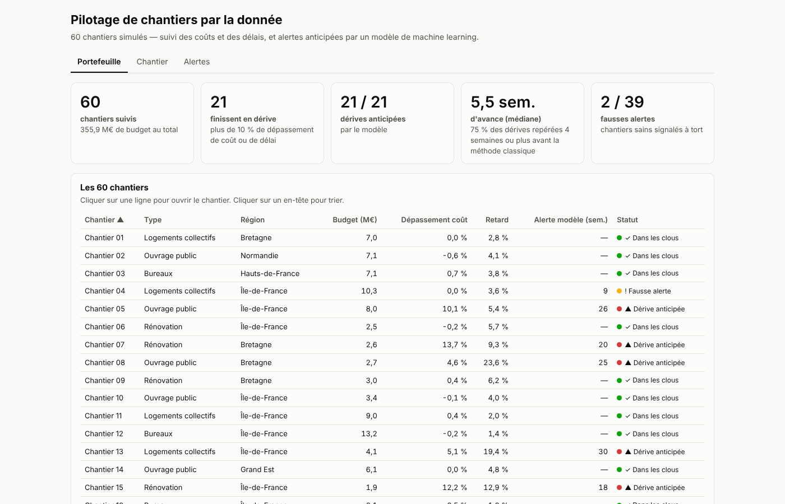

# Pilotage de chantiers par la donnée et anticipation des dérives

Projet personnel — **Frédéric Marcel TCHOUEN**, élève ingénieur en 5e année à l'ESIGELEC (Big Data & Transformation Numérique).

## Le problème
Sur un chantier, on découvre souvent trop tard qu'il va coûter plus cher ou finir en retard. Les indicateurs classiques de gestion de projet (méthode de la valeur acquise) signalent la dérive quand elle est déjà installée.

**Objectif :** repérer **au moins 4 semaines plus tôt** les chantiers qui vont dépasser de plus de **10 %** leur budget ou leur délai, et suivre chaque chantier dans un tableau de bord.

## Résultats

| Méthode | Dérives repérées | Fausses alertes | Avance médiane | Dérives repérées 4 semaines ou plus avant |
|---|---|---|---|---|
| Méthode classique (CPI ou SPI < 0,909) | 20 / 21 | 0 / 39 | référence | — |
| Régression logistique | 21 / 21 | 3 / 39 | 4,5 semaines | 60 % |
| **Forêt aléatoire (modèle retenu)** | **21 / 21** | **2 / 39** | **5,5 semaines** | **75 %** |

Le modèle repère **toutes les dérives**, avec une avance médiane de **5,5 semaines** sur la méthode classique (calculée sur les 20 dérives que la méthode classique finit aussi par repérer), et seulement **2 fausses alertes** sur 39 chantiers sains.

> Le seuil d'alerte (80 %, deux semaines de suite) a été choisi en comparant plusieurs seuils sur la validation croisée : ces chiffres sont donc légèrement optimistes et seraient à confirmer sur de nouveaux chantiers.

## Les 3 étapes

### 1. Les données et les indicateurs
- **60 chantiers** simulés de 4 types (logements collectifs, bureaux, rénovation, ouvrage public), 5 régions, 12 conducteurs de travaux.
- **10 lots** par chantier (terrassement, gros œuvre, électricité…), avec leur **planning prévu** semaine par semaine.
- **24 757 lignes de pointage** : dépenses, heures et avancement réel de chaque lot, chaque semaine.
- Environ 1 chantier sur 3 subit une dérive réaliste : hausse du prix des matériaux, retards météo ou sous-effectif. **21 chantiers** finissent avec plus de 10 % de dépassement.
- Base **SQL** avec **4 contrôles de qualité** au chargement (tous à 0) et calcul des indicateurs de la **méthode de la valeur acquise** :

| Indicateur | Calcul | Question |
|---|---|---|
| PV (valeur planifiée) | budget × avancement prévu | Qu'aurait-on dû réaliser ? |
| EV (valeur acquise) | budget × avancement réel | Qu'a-t-on réellement réalisé ? |
| AC (coût réel) | somme des dépenses | Combien ça a coûté ? |
| **CPI** = EV / AC | | < 1 : on dépense plus que prévu |
| **SPI** = EV / PV | | < 1 : on est en retard |

### 2. Le modèle d'anticipation ([`src/modele_anticipation.py`](src/modele_anticipation.py))
- **Question posée chaque semaine :** ce chantier va-t-il finir avec plus de 10 % de dépassement ?
- **Variables** ([`src/features.py`](src/features.py)) : uniquement ce que le conducteur de travaux connaît à cette date. Ce sont le CPI et le SPI, leur évolution sur 4 semaines, l'écart entre budget consommé et avancement, la vitesse d'avancement par rapport au planning, et les heures pointées par euro dépensé (utile pour repérer un sous-effectif).
- **Validation croisée par chantier** (5 plis) : un chantier n'est jamais à la fois dans l'entraînement et dans le test.
- **Alerte** : probabilité de dérive d'au moins 80 %, deux semaines de suite.
- **Variables les plus utiles** : CPI, SPI, écart entre budget consommé et avancement, avancement, tendance du CPI.

### 3. Le tableau de bord ([`dashboard/index.html`](dashboard/index.html))


Page web autonome à ouvrir dans un navigateur, avec trois vues :
- **Portefeuille** : chiffres clés et tableau des 60 chantiers avec leur statut ;
- **Chantier** : courbes prévu / réalisé / dépensé, CPI et SPI, score de risque, avec la semaine d'alerte du modèle et celle du constat classique ;
- **Alertes** : chantiers signalés, avance prise et cause probable (coût ou délai).

Les données sont aussi exportées en **modèle en étoile pour Power BI** (`data/powerbi/`), avec un guide pas à pas : [`docs/Guide_Power_BI.docx`](docs/Guide_Power_BI.docx).

## Lancer le projet
```bash
pip install -r requirements.txt
python src/generer_donnees.py        # 1. crée les données dans data/
python src/charger_base.py           # 1. base SQL, contrôles de qualité, indicateurs
python src/modele_anticipation.py    # 2. entraîne et évalue le modèle
python src/tableau_de_bord.py        # 3. génère dashboard/index.html
python src/export_powerbi.py         # 3. exporte les données pour Power BI
python tests/test_projet.py          # tests (ou : python -m pytest -v)
```

## Structure
```
data/        données CSV, base SQLite, scores de risque, export Power BI
sql/         schema.sql (tables et contraintes), indicateurs.sql (valeur acquise)
src/         génération, chargement, variables, modèle, tableau de bord, export Power BI
dashboard/   tableau de bord (page web)
tests/       contrôles de qualité et performances minimales du modèle
docs/        guide Power BI
```

⚠️ `data/verite_derives_NE_PAS_UTILISER_EN_ENTREE.csv` indique quelles dérives ont été simulées. Il ne sert qu'à vérifier les données, jamais à entraîner le modèle.

## Limites et pistes
- Données simulées : l'intérêt est la méthode, pas les valeurs. Sur des chantiers réels, il faudrait plus d'historique et recalibrer le seuil.
- 60 chantiers, c'est peu pour un modèle de machine learning : les résultats sont à confirmer à plus grande échelle.
- Pistes : expliquer chaque alerte (SHAP), prévoir le montant du dépassement et pas seulement sa probabilité, connecter le tableau de bord à des données mises à jour chaque semaine.
